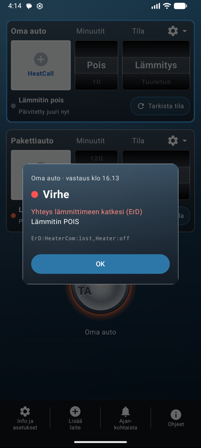

# HeatCall – Diesel heater SMS control

**English** · [Suomeksi ↓](#suomeksi)

HeatCall is an Android app for controlling an Eberspächer parking heater (Hydronic or Airtronic) through the **EasyStart Call** GSM remote control. It replaces the manufacturer's original app, which is no longer supported and does not work on recent Android versions.

Commands are sent as text messages in the background. The heater's reply opens in plain language in the app, and the same message is marked as read in your messaging app. HeatCall is **free and open source** ([MIT License](LICENSE)), with no ads, no analytics and no internet permission.

- Start and stop with run time (10–120 min, or continuous for air heaters) and mode (heating or ventilation)
- Status check in the app and on a home screen widget
- Three weekly timers with departure time
- Device clock setting with a reminder when summer or winter time begins
- Several cars, message history, and error codes explained
- English and Finnish

**[User guide in English → docs/en/USER-GUIDE.md](docs/en/USER-GUIDE.md)** · [Download APK](https://github.com/Konderi/HeatCall/releases) · Requires Android 10+

### Documentation

Every document is available in English and Finnish.

| Document | English | Suomi |
|---|---|---|
| Features with screenshots | [FEATURES.md](docs/en/FEATURES.md) | [ESITTELY.md](docs/ESITTELY.md) |
| User guide: usage, widget, timers, troubleshooting | [USER-GUIDE.md](docs/en/USER-GUIDE.md) | [KAYTTOOHJE.md](docs/KAYTTOOHJE.md) |
| Installation: APK, permissions, updates | [INSTALLATION.md](docs/en/INSTALLATION.md) | [ASENNUS.md](docs/ASENNUS.md) |
| EasyStart Call SMS commands and replies | [SMS-PROTOCOL.md](docs/en/SMS-PROTOCOL.md) | [SMS-PROTOKOLLA.md](docs/SMS-PROTOKOLLA.md) |
| Development: architecture, building, testing | [DEVELOPMENT.md](docs/en/DEVELOPMENT.md) | [KEHITYS.md](docs/KEHITYS.md) |
| Google Play release | [PLAY-RELEASE.md](docs/en/PLAY-RELEASE.md) | [PLAY-JULKAISU.md](docs/PLAY-JULKAISU.md) |
| Play: steps, forms, store texts, testers | [RELEASE-STEPS.md](docs/en/play/RELEASE-STEPS.md) · [FORMS.md](docs/en/play/FORMS.md) | [JULKAISU.md](docs/play/JULKAISU.md) · [LOMAKKEET.md](docs/play/LOMAKKEET.md) |
| Store listing texts and tester invitation (both languages in one file) | [KAUPPA-TEKSTIT.md](docs/play/KAUPPA-TEKSTIT.md) · [TESTAAJAT.md](docs/play/TESTAAJAT.md) | ← |
| Brochure (PDF) | [HeatCall-brochure-en-fi.pdf](docs/esite/HeatCall-brochure-en-fi.pdf) | [HeatCall-esite.pdf](docs/esite/HeatCall-esite.pdf) |

### Building

Requires Android Studio, which includes the JDK and Android SDK: `./gradlew testDebugUnitTest assembleRelease`. See [DEVELOPMENT.md](docs/en/DEVELOPMENT.md).

> HeatCall is an independent app. It is not a product of Eberspächer Climate Control Systems GmbH and is not endorsed by it.

---

## Suomeksi

HeatCall on Android-sovellus Eberspächer-seisontalämmittimen ohjaamiseen **EasyStart Call** -puhelinkauko-ohjaimen kautta. Sovellus korvaa valmistajan alkuperäisen sovelluksen, jonka tuki on päättynyt ja joka ei enää toimi uusissa Android-versioissa.

Sovellus lähettää komennot tekstiviesteinä taustalla. Lämmittimen vastaus näytetään sovelluksen omassa ikkunassa, ja sama viesti merkitään luetuksi puhelimen viestisovelluksessa.

HeatCall on ilmainen ja avointa lähdekoodia ([MIT-lisenssi](LICENSE)).

> HeatCall ei ole Eberspächerin tuote, eikä valmistaja tue sitä.

<table>
<tr>
<td align="center" width="25%"><br><sub>Ohjaus: käyntiaika, tila ja useampi auto</sub></td>
<td align="center" width="25%"><br><sub>Vastaus omassa ikkunassa</sub></td>
<td align="center" width="25%"><br><sub>Kotinäytön widget</sub></td>
<td align="center" width="25%"><br><sub>Ajastimet T1–T3</sub></td>
</tr>
<tr>
<td align="center"><br><sub>Sammutus</sub></td>
<td align="center"><br><sub>Laitteen kello ja kesä-/talviaika</sub></td>
<td align="center"><br><sub>Virheet selitettyinä</sub></td>
<td align="center"><br><sub>Viestihistoria</sub></td>
</tr>
</table>

**[Katso kaikki ominaisuudet kuvineen → docs/ESITTELY.md](docs/ESITTELY.md)**

## Ominaisuudet

- **Käynnistys ja sammutus:** käyntiaika (10–120 min tai kestokäyttö ilmalämmittimille) ja tila (lämmitys tai tuuletus) valitaan rullilla, ja komento lähtee kromatusta KÄYNNISTÄ- tai SAMMUTA-painikkeesta.
- **Tilan tarkistus:** jokaisessa autokortissa on tilarivi ja Tarkista tila -painike.
- **Kotinäytön widget:** näyttää lämmittimen tilan, ja tilan voi tarkistaa avaamatta sovellusta.
- **Vastausikkuna:** lämmittimen vastaus suomennetaan, esimerkiksi `Heater:on,run:30` → "Lämmitin päällä, käyntiaika 30 min".
- **Luetuksi merkintä:** vastausviesti merkitään luetuksi oletusviestisovelluksessa (Google Messages, Samsung Messages ym.).
- **Ajastimet:** kolme viikkoajastinta (T1–T3) lähtöajalla ja käyntiajalla.
- **Useampi auto:** jokaisella autolla on oma numero, PIN-koodi, lämmitintyyppi ja kuva.
- **Laitteen kello:** asetus puhelimen ajasta tai käsin, kellon poikkeaman tunnistus ja muistutus kesä- ja talviajan vaihtuessa.
- **Laitetoiminnot:** sisälämpötila ja oman numeron valtuutus.
- **Viestihistoria:** lähetetyt komennot ja vastaukset. PIN-koodi peitetään historiassa.
- **Lupaopastus:** sovellus tunnistaa estetyt luvat ja ohjaa sallimaan rajoitetut asetukset (Android 13+ ja ColorOS).
- **Kieli:** suomi tai englanti. Kieli valitaan ensimmäisellä käynnistyskerralla tai myöhemmin asetuksista, ja virhekoodit (ErD, ErH, ErC, ErR, ErL) selitetään valitulla kielellä.

## Pika-aloitus

1. Lataa uusin APK [Releases](https://github.com/Konderi/HeatCall/releases)-sivulta ja asenna se, ks. [Asennus](docs/ASENNUS.md).
2. Valitse kieli (Suomi / English) ja anna lämmittimen SIM-kortin **puhelinnumero** ja **PIN-koodi** (tehdasasetus 1234).
3. Salli tekstiviestit ja ilmoitukset. Jos Android ilmoittaa *"Sovelluksen lupa kielletty"* tai Salli on harmaana, HeatCall näyttää korjausohjeen. Ohje on myös tiedostossa [Asennus → Rajoitetut asetukset](docs/ASENNUS.md#rajoitetut-asetukset).
4. Anna kohdassa *Info ja asetukset* ilmoitusten käyttöoikeus, jotta vastaukset merkitään luetuiksi.
5. Paina **Tarkista tila**. Kun lämmitin vastaa, yhteys toimii.

## Dokumentaatio

Kaikki dokumentit ovat suomeksi ja englanniksi, ks. [taulukko yllä](#documentation). Tärkeimmät:

- [Esittely](docs/ESITTELY.md): kaikki ominaisuudet kuvakaappauksin
- [Käyttöohje](docs/KAYTTOOHJE.md): sovelluksen käyttö, widget, ajastimet ja vianetsintä
- [Asennus](docs/ASENNUS.md): APK:n asennus kaapelilla tai ilman, käyttöoikeudet ja päivitykset
- [SMS-protokolla](docs/SMS-PROTOKOLLA.md): EasyStart Callin komennot ja vastausten muodot
- [Kehittäjälle](docs/KEHITYS.md): arkkitehtuuri, buildaus, testaus ja emulaattori
- [Play-julkaisu](docs/PLAY-JULKAISU.md) ja [vaiheet ja materiaalit](docs/play/JULKAISU.md)

## Buildaus lyhyesti

Vaatii Android Studion (Rabbit 2 tai uudempi), joka tuo mukanaan JDK:n ja Android SDK:n.

```bash
export JAVA_HOME="/Applications/Android Studio.app/Contents/jbr/Contents/Home"
./gradlew testDebugUnitTest assembleRelease
```

Valmis APK: `app/build/outputs/apk/release/app-release.apk`. Lisätietoja on tiedostossa [docs/KEHITYS.md](docs/KEHITYS.md).

## Tekniikka

Kotlin · Jetpack Compose (Material 3) · DataStore · Android Gradle Plugin 9.5 · minSdk 29 (Android 10) · targetSdk 36 · compileSdk 37
