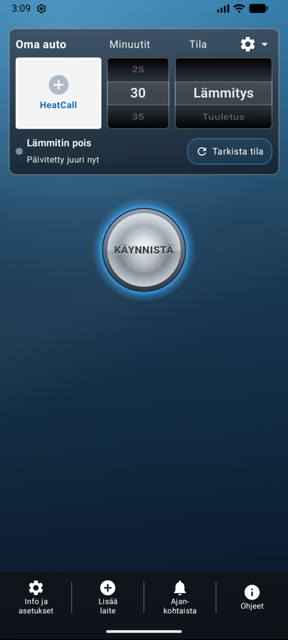
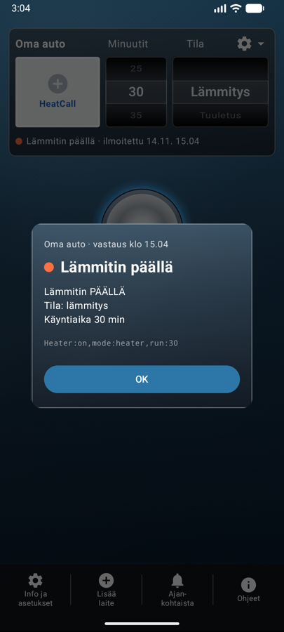
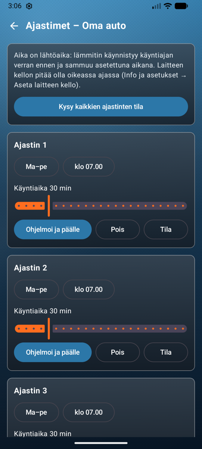
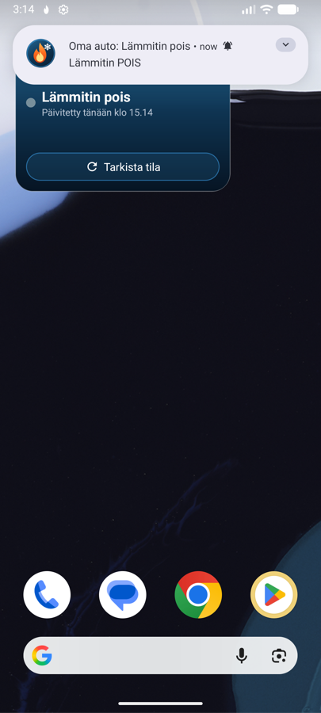

# HeatCall – Diesel-lämmittimen SMS-ohjaus

HeatCall on Android-sovellus Eberspächer-seisontalämmittimen ohjaamiseen **EasyStart Call** -puhelinkauko-ohjaimen kautta. Sovellus korvaa valmistajan alkuperäisen sovelluksen, jonka tuki on päättynyt ja joka ei enää toimi uusissa Android-versioissa.

Sovellus lähettää komennot tekstiviesteinä taustalla. Lämmittimen vastaus näytetään sovelluksen omassa ikkunassa, ja sama viesti merkitään luetuksi puhelimen viestisovelluksessa.

> Sovellus on tehty omaan käyttöön. Se ei ole Eberspächerin tuote, eikä valmistaja tue sitä.

<p>
  
  
  
  
</p>

## Ominaisuudet

- **Käynnistys ja sammutus:** käyntiaika (10–120 min tai kestokäyttö ilmalämmittimille) ja tila (lämmitys tai tuuletus) valitaan rullilla, ja komento lähtee kromatusta KÄYNNISTÄ- tai SAMMUTA-painikkeesta.
- **Tilan tarkistus:** jokaisessa autokortissa on tilarivi ja Tarkista tila -painike.
- **Kotinäytön widget:** näyttää lämmittimen tilan, ja tilan voi tarkistaa avaamatta sovellusta.
- **Vastausikkuna:** lämmittimen vastaus suomennetaan, esimerkiksi `Heater:on,run:30` → "Lämmitin päällä, käyntiaika 30 min".
- **Luetuksi merkintä:** vastausviesti merkitään luetuksi oletusviestisovelluksessa (Google Messages, Samsung Messages ym.).
- **Ajastimet:** kolme viikkoajastinta (T1–T3) lähtöajalla ja käyntiajalla.
- **Useampi auto:** jokaisella autolla on oma numero, PIN-koodi, lämmitintyyppi ja kuva.
- **Laitetoiminnot:** laitteen kellon asetus puhelimen ajasta, sisälämpötila ja oman numeron valtuutus.
- **Viestihistoria:** lähetetyt komennot ja vastaukset. PIN-koodi peitetään historiassa.
- **Lupaopastus:** sovellus tunnistaa estetyt luvat ja ohjaa sallimaan rajoitetut asetukset (Android 13+ ja ColorOS).
- **Kieli:** käyttöliittymä on kokonaan suomeksi, ja virhekoodit (ErD, ErH, ErC, ErR, ErL) selitetään.

## Pika-aloitus

1. Asenna `HeatCall-1.1.apk` puhelimeen, ks. [Asennus](docs/ASENNUS.md).
2. Ensimmäisellä käynnistyskerralla anna lämmittimen SIM-kortin **puhelinnumero** ja **PIN-koodi** (tehdasasetus 1234).
3. Salli tekstiviestit ja ilmoitukset. Jos Android ilmoittaa *"Sovelluksen lupa kielletty"* tai Salli on harmaana, HeatCall näyttää korjausohjeen. Ohje on myös tiedostossa [Asennus → Rajoitetut asetukset](docs/ASENNUS.md#rajoitetut-asetukset).
4. Anna kohdassa *Info ja asetukset* ilmoitusten käyttöoikeus, jotta vastaukset merkitään luetuiksi.
5. Paina **Tarkista tila**. Kun lämmitin vastaa, yhteys toimii.

## Dokumentaatio

| Dokumentti | Sisältö |
|---|---|
| [Käyttöohje](docs/KAYTTOOHJE.md) | Sovelluksen käyttö, widget, ajastimet ja vianetsintä |
| [Asennus](docs/ASENNUS.md) | APK:n asennus kaapelilla tai ilman, käyttöoikeudet ja päivitykset |
| [SMS-protokolla](docs/SMS-PROTOKOLLA.md) | EasyStart Callin komennot ja vastausten muodot |
| [Kehittäjälle](docs/KEHITYS.md) | Arkkitehtuuri, buildaus, testaus ja emulaattori |
| [Play-julkaisu](docs/PLAY-JULKAISU.md) | Mitä julkaisu Google Play -kauppaan vaatisi |

## Buildaus lyhyesti

Vaatii Android Studion (Rabbit 2 tai uudempi), joka tuo mukanaan JDK:n ja Android SDK:n.

```bash
export JAVA_HOME="/Applications/Android Studio.app/Contents/jbr/Contents/Home"
./gradlew testDebugUnitTest assembleRelease
```

Valmis APK: `app/build/outputs/apk/release/app-release.apk`. Lisätietoja on tiedostossa [docs/KEHITYS.md](docs/KEHITYS.md).

## Tekniikka

Kotlin · Jetpack Compose (Material 3) · DataStore · Android Gradle Plugin 9.5 · minSdk 29 (Android 10) · targetSdk 36 · compileSdk 37
