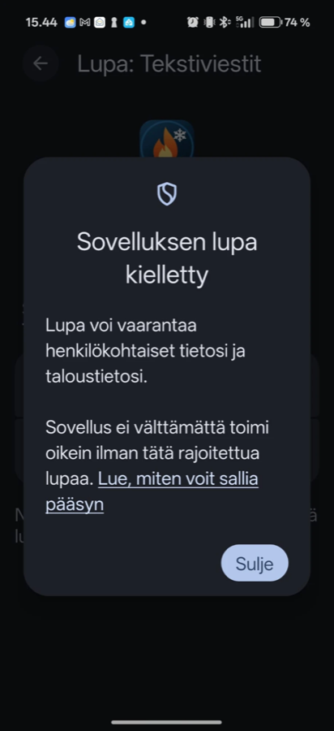
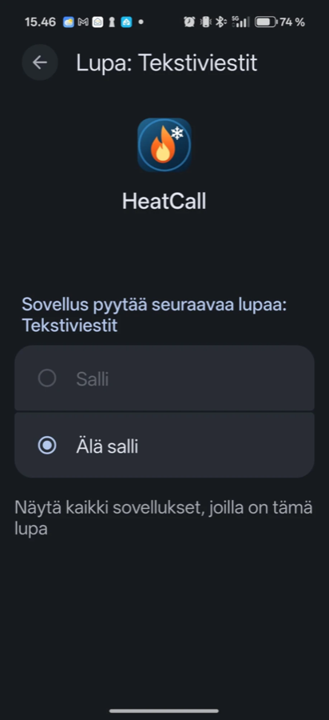
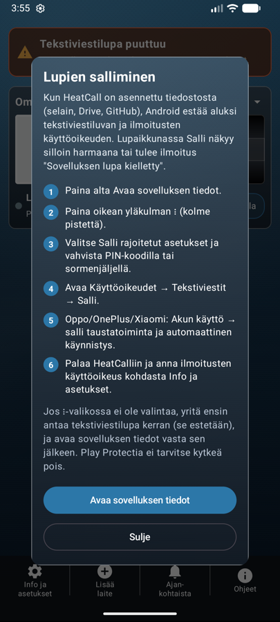
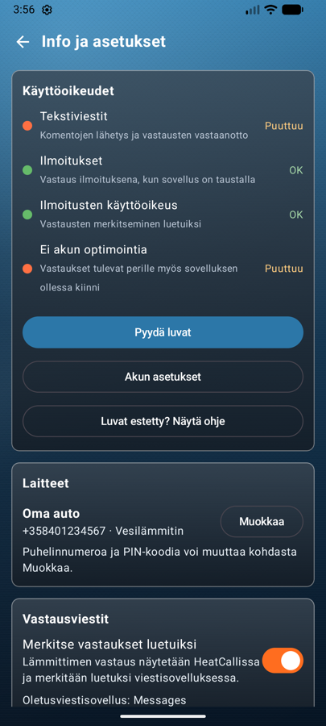

# HeatCall – asennus

**Suomi** · [English](en/INSTALLATION.md)

HeatCall on tulossa Google Play -kauppaan. Siihen asti se asennetaan APK-tiedostosta (niin sanottu sivulataus). Sovellus toimii Android 10:ssä ja uudemmissa.

## APK-tiedosto

Lataa uusin APK [Releases](https://github.com/Konderi/HeatCall/releases)-sivulta.

Kun buildaat itse, APK löytyy kahdesta paikasta:

| Polku | Kuvaus |
|---|---|
| `app/build/outputs/apk/release/app-release.apk` | Gradlen tuottama release-APK |
| `dist/HeatCall-<versio>.apk` | Sama tiedosto jakoa varten nimettynä, esim. `HeatCall-1.1.apk` (ei versionhallinnassa) |

Buildaus, ks. [KEHITYS.md](KEHITYS.md#buildaus).

## Tapa 1: USB-kaapeli (suositeltu)

1. Ota puhelimessa käyttöön kehittäjäasetukset: **Asetukset → Tietoja puhelimesta → Koontiversionumero**, napauta 7 kertaa.
2. **Asetukset → Järjestelmä → Kehittäjäasetukset → USB-virheenkorjaus** päälle.
3. Kytke puhelin Maciin ja hyväksy puhelimessa virheenkorjaus.
4. Joko Android Studiossa: avaa projekti, valitse puhelin ja paina ▶ **Run**, tai komentorivillä:

```bash
~/Library/Android/sdk/platform-tools/adb install -r dist/HeatCall-1.1.apk
```

Kaapeliasennuksessa Android ei käsittele sovellusta "tuntemattomasta lähteestä" tulevana, joten [rajoitetut asetukset](#rajoitetut-asetukset) eivät koske sitä.

## Tapa 2: Ilman kaapelia

APK:n voi siirtää puhelimeen myös ilman kaapelia.

### Sähköposti – ei toimi Gmaililla

**Gmail estää `.apk`-liitteet**, myös zip-pakattuina, joten sähköposti ei ole luotettava tapa. Muut sähköpostipalvelut voivat toimia, mutta pilvilinkki on varmempi.

### Toimivat tavat

| Tapa | Ohje |
|---|---|
| **Google Drive / iCloud Drive / OneDrive** | Lataa APK pilveen Macilta ja avaa se puhelimessa pilvipalvelun sovelluksesta tai selaimesta. |
| **GitHub Release** | Avaa [Releases](https://github.com/Konderi/HeatCall/releases) puhelimen selaimessa ja lataa APK. |
| **Quick Share / Lähijako** | Jaa tiedosto suoraan toisesta Android-laitteesta tai Windows-koneesta. |
| **Langaton virheenkorjaus** | Android 11+: Kehittäjäasetukset → Langaton virheenkorjaus → Muodosta pari koodilla. Sen jälkeen `adb pair` ja `adb connect`, minkä jälkeen asennus toimii kuten kaapelilla. |

### Asennus puhelimessa

1. Avaa ladattu APK, esim. `HeatCall-1.1.apk` (Tiedostot → Lataukset).
2. Android kysyy luvan asentaa tuntemattomia sovelluksia siitä sovelluksesta, josta tiedosto avattiin (selain, Drive, Tiedostot). Salli lupa.
3. **Play Protect** voi varoittaa tuntemattomasta kehittäjästä. Valitse **Lisätietoja → Asenna silti**. Varoitus johtuu siitä, että sovellusta ei ole julkaistu Play-kaupassa.
4. Avaa HeatCall ja tee [ensimmäisen käynnistyksen](KAYTTOOHJE.md#1-ensimmäinen-käynnistys) asetukset.

## Rajoitetut asetukset

Android 13:sta alkaen tiedostosta, selaimesta, Drivesta tai GitHubista asennettu sovellus ei saa heti pyytää arkaluonteisia oikeuksia. HeatCallin kohdalla tämä koskee:

- **tekstiviestilupaa**, jota ilman sovellus ei toimi lainkaan
- **ilmoitusten käyttöoikeutta**, jota luetuksi merkintä tarvitsee

USB-kaapelilla (`adb install` tai Android Studio) asennettuun sovellukseen tämä ei koske.

### Oireet

<p>
  
  
</p>

- Kun lupaa yrittää antaa, tulee ilmoitus **"Sovelluksen lupa kielletty – Lupa voi vaarantaa henkilökohtaiset tietosi ja taloustietosi"**.
- Lupasivulla **Lupa: Tekstiviestit** on valittuna *Älä salli*, ja **Salli** näkyy harmaana.
- HeatCallin päänäkymässä näkyy oranssi varoitus **Tekstiviestilupa puuttuu**.

### Korjaus

1. Sulje ilmoitus. Lupaa pitää yrittää antaa kerran, koska sallimisvalinta ilmestyy vasta sen jälkeen.
2. Avaa HeatCallin **sovellustiedot** eli sivu, jossa ovat *Poista asennus* ja *Pakota lopetus*:
   - HeatCallissa: napauta varoitusta tai **Info ja asetukset → Luvat estetty? Näytä ohje → Avaa sovelluksen tiedot**, tai
   - paina HeatCallin kuvaketta pitkään → **ⓘ Sovelluksen tiedot**, tai
   - **Asetukset → Sovellukset → (Sovellusten hallinta) → HeatCall**
3. Paina oikean yläkulman **⋮** → **Salli rajoitetut asetukset** ja vahvista PIN-koodilla tai sormenjäljellä.
4. **Käyttöoikeudet → Tekstiviestit → Salli**. Salli on nyt valittavissa.
5. Palaa HeatCalliin. Anna ilmoitusten käyttöoikeus kohdasta **Info ja asetukset → Vastausviestit → Anna käyttöoikeus**.

Huomaa: pelkältä lupasivulta (*Lupa: Tekstiviestit*) ⋮-valikkoa ei löydy. Se on sovelluksen **pääsivulla**.

### Sovelluksen oma opastus

<p>
  
  
</p>

- Jos tekstiviestilupa evätään, HeatCall avaa automaattisesti ohjeen **Lupien salliminen**, jossa on painike **Avaa sovelluksen tiedot**.
- **Info ja asetukset → Käyttöoikeudet** näyttää kaikkien lupien tilan (OK / Puuttuu): tekstiviestit, ilmoitukset, ilmoitusten käyttöoikeus ja akun optimointi.

## Oppo / OnePlus / Realme (ColorOS)

ColorOS-puhelimilla todettiin seuraavat erot. Testilaite: Oppo Find 9X Pro.

| Tilanne | Ratkaisu |
|---|---|
| Asennusohjelma tekee tietoturvatarkistuksen tai pyytää OPPO-tiliä | Valitse alareunasta **Asenna ilman tarkistusta** tai **Asenna silti**. Kirjautumista ei tarvita. |
| "Asenna tuntemattomia sovelluksia" -asetusta ei löydy | **Asetukset → Salasana ja suojaus → Järjestelmän suojaus → Asenna tuntemattomia sovelluksia**, **Asetukset → Sovellukset → Sovellusten erikoiskäyttöoikeudet**, tai Asetusten haku "tuntemattom". Lupa annetaan sille sovellukselle (Chrome, Tiedostonhallinta), jolla APK avataan. |
| **Play Protect** -asetus on harmaana | Play Protectia **ei tarvitse** kytkeä pois. Asennusvaroituksessa riittää *Lisätietoja → Asenna silti*. Kytkin on harmaana esimerkiksi puhelun aikana (Googlen huijaussuojaus). |
| Tekstiviestilupa estetty, Salli harmaana | Katso [Rajoitetut asetukset](#rajoitetut-asetukset). |
| Vastaukset tai widget eivät päivity sovelluksen ollessa kiinni | **Info ja asetukset → Käyttöoikeudet → Taustatoiminnan asetukset**. HeatCall tunnistaa puhelimen merkin ja näyttää oikean polun: ColorOS:ssa *Sovellustiedot → Akun käyttö* → salli **taustatoiminta** ja **automaattinen käynnistys**. |

Valikkojen nimet vaihtelevat ColorOS-versioittain. Jos kohtaa ei löydy, käytä Asetusten hakua.

Muissa merkeissä (Samsung, Xiaomi, Pixel) rajoitettujen asetusten korjaus on sama.

## Taustatoiminta merkeittäin

**Info ja asetukset → Käyttöoikeudet → Taustatoiminnan asetukset** tunnistaa puhelimen valmistajan ja näyttää oikeat vaiheet ja painikkeet. Jos tunnistus osuu väärin, merkin voi vaihtaa ikkunan valinnoista.

| Merkki | Asetus | Painikkeet |
|---|---|---|
| Samsung (One UI) | Sovellustiedot → Akku → **Rajoittamaton**. Lisäksi Laitteen ylläpito → Akku → Taustakäytön rajoitukset → **Ei koskaan nukkuvat sovellukset** → HeatCall | Sovelluksen tiedot, akun asetukset |
| Google Pixel | Sovellustiedot → Sovelluksen akunkäyttö → **Rajoittamaton** | Sovelluksen tiedot |
| OPPO / OnePlus / realme (ColorOS) | Sovellustiedot → Akun käyttö → **Salli taustatoiminta** ja **Salli automaattinen käynnistys** | Sovelluksen tiedot, automaattinen käynnistys |
| Xiaomi / Redmi / POCO (HyperOS/MIUI) | **Automaattinen käynnistys** sallittu, Akku → **Ei rajoituksia** | Automaattinen käynnistys, akun asetukset |

Valmistajien omat asetusnäkymät vaihtelevat malleittain. Jos näkymää ei löydy, HeatCall avaa sovelluksen tietosivun ja kertoo siitä.

## Päivittäminen

Uusi versio asennetaan vanhan päälle samalla tavalla. Tiedot (laitteet, ajastimet, historia) säilyvät.

**Allekirjoitus:** päivitys onnistuu vain, jos uusi APK on allekirjoitettu **samalla avaimella** kuin asennettu versio. Tällä hetkellä release-build allekirjoitetaan buildikoneen Android-debug-avaimella (`~/.android/debug.keystore`). Siksi:

- Buildaa päivitykset samalla Macilla, tai kopioi `debug.keystore` talteen.
- Jos avain vaihtuu, vanha versio pitää poistaa ennen uuden asennusta. Tällöin tiedot katoavat.

Jos sovellusta halutaan jakaa laajemmin, kannattaa luoda oma release-avain. Ohje on tiedostossa [KEHITYS.md](KEHITYS.md#allekirjoitus).

## Toiseen puhelimeen

Sama APK toimii missä tahansa Android 10+ -puhelimessa. Jokaiseen puhelimeen syötetään lämmittimen numero ja PIN erikseen. Jos haluat, että myös toinen puhelin saa lämmittimen virheilmoitukset, valtuuta se kohdasta **Info ja asetukset → Valtuuta tämä puhelin**. Huomaa, että EasyStart Callissa voi olla vain yksi valtuutettu numero kerrallaan.
