# HeatCall – esittely

**Suomi** · [English](en/FEATURES.md)

HeatCall ohjaa Eberspächer-seisontalämmitintä EasyStart Call -yksikön kautta tekstiviesteillä. Ulkoasu on tumma ja selkeä: sininen tausta, rullavalitsimet ja iso käynnistyspainike. Sovellus on suomeksi ja englanniksi.

Kuvakaappaukset on otettu Android 17 -emulaattorissa simuloiduilla lämmittimen vastauksilla. Niissä näkyvät puhelinnumerot ovat testinumeroita.

---

## Ohjaus

<table>
<tr>
<td width="33%">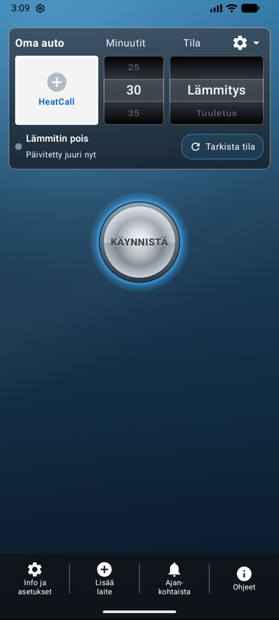</td>
<td width="33%">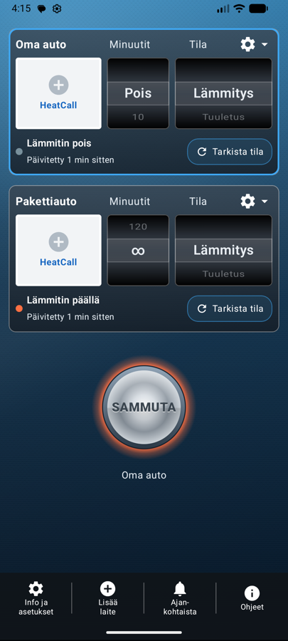</td>
<td width="33%">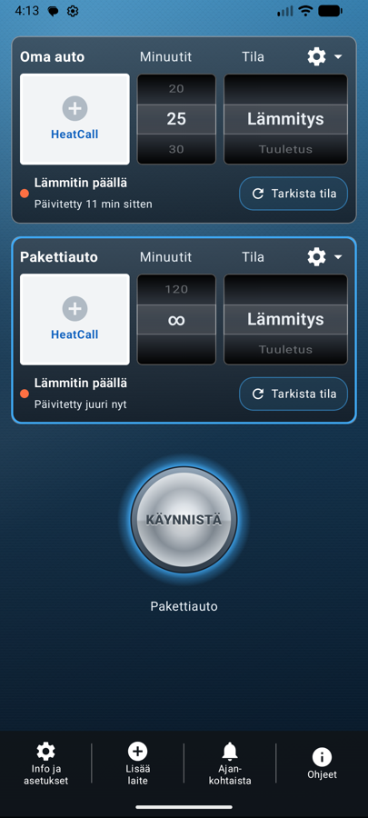</td>
</tr>
<tr>
<td><b>Käynnistys</b> Valitse käyntiaika Minuutit-rullalla ja tila Tila-rullalla, ja paina <b>KÄYNNISTÄ</b>. Komento lähtee tekstiviestinä taustalla.</td>
<td><b>Sammutus</b> Kun Minuutit-rullassa on <b>Pois</b>, painike muuttuu oranssiksi <b>SAMMUTA</b>-painikkeeksi.</td>
<td><b>Useampi auto</b> Jokaisella autolla on oma kortti, numero, PIN ja lämmitintyyppi. Valittu auto näkyy sinisellä reunuksella. Ilmalämmittimellä rullassa on myös <b>∞</b> eli kestokäyttö.</td>
</tr>
</table>

## Tila ja vastaukset

<table>
<tr>
<td width="33%">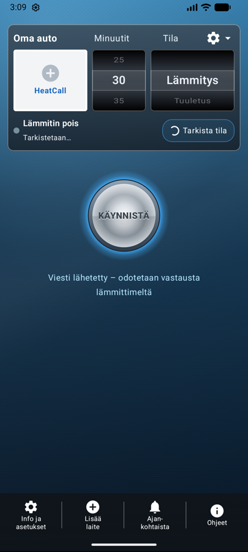</td>
<td width="33%">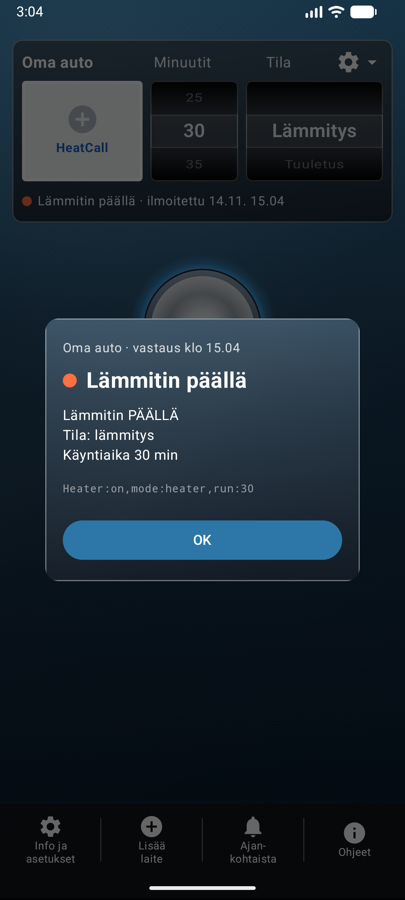</td>
<td width="33%">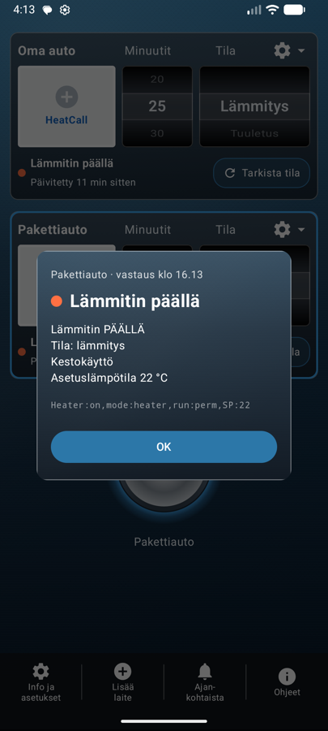</td>
</tr>
<tr>
<td><b>Tarkista tila</b> Kortin painike lähettää tilakyselyn. Tilarivi näyttää viimeisimmän tilan ja milloin se päivittyi.</td>
<td><b>Vastausikkuna</b> Lämmittimen vastaus avautuu omaan ikkunaansa selkokielellä tulkittuna, ja sama viesti merkitään luetuksi viestisovelluksessa.</td>
<td><b>Ilmalämmitin</b> Kestokäyttö ja asetuslämpötila tulkitaan ja näytetään selkokielellä.</td>
</tr>
<tr>
<td width="33%">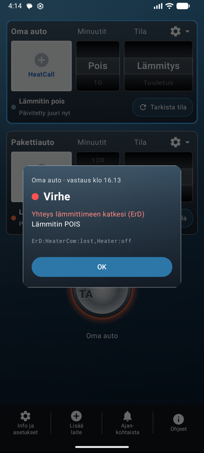</td>
<td width="33%">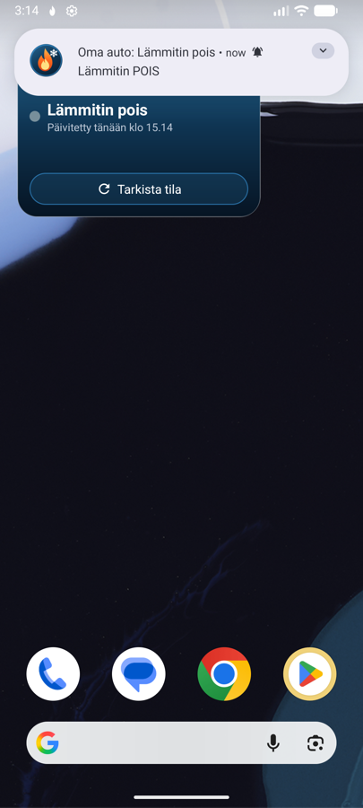</td>
<td width="33%">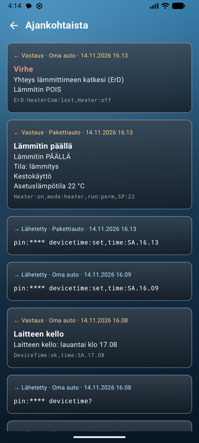</td>
</tr>
<tr>
<td><b>Virheilmoitukset</b> Virhekoodit (ErD, ErH, ErC, ErR, ErL) selitetään sovelluksen kielellä.</td>
<td><b>Kotinäytön widget ja ilmoitus</b> Widgetistä näkee tilan ja voi tarkistaa sen avaamatta sovellusta. Kun sovellus on taustalla, vastaus tulee ilmoituksena.</td>
<td><b>Ajankohtaista</b> Viestihistoria: lähetetyt komennot (PIN-koodi peitettynä) ja tulkitut vastaukset.</td>
</tr>
</table>

## Ajastimet ja laitteen kello

<table>
<tr>
<td width="33%">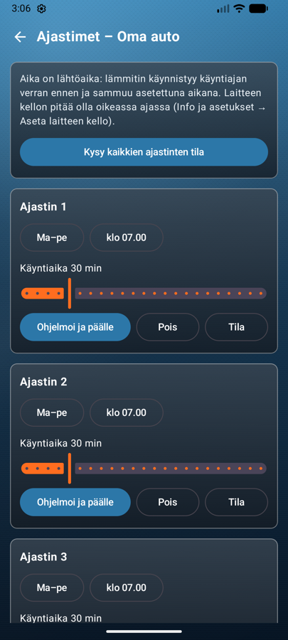</td>
<td width="33%">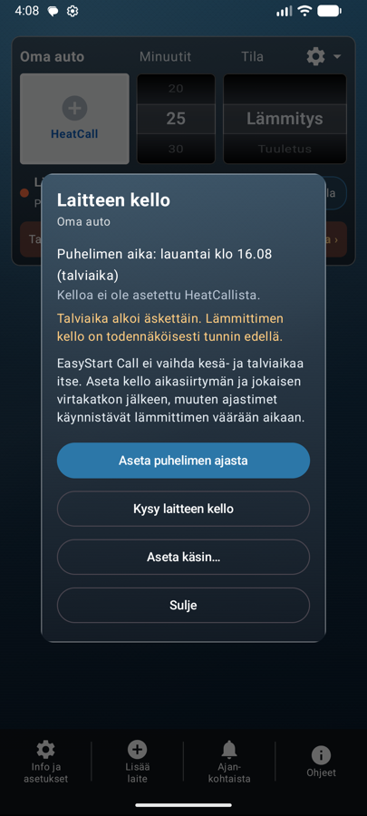</td>
<td width="33%">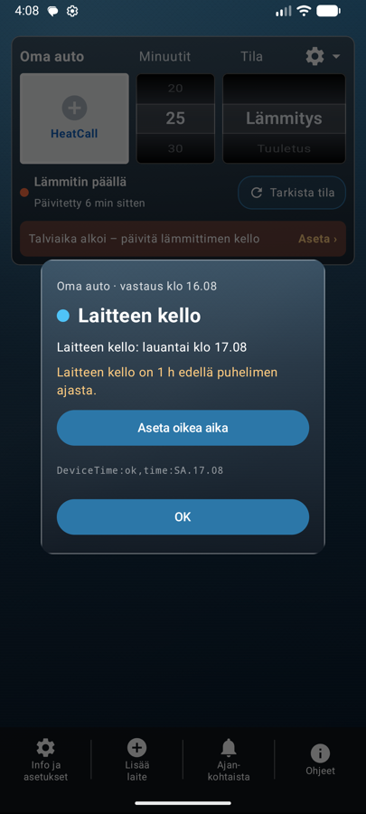</td>
</tr>
<tr>
<td><b>Ajastimet T1–T3</b> Päivä tai päiväväli (ma–pe, la–su, joka päivä), lähtöaika ja käyntiaika. Ohjelmoi, kytke pois tai kysy tila.</td>
<td><b>Laitteen kello</b> Aseta kello puhelimen ajasta, kysy se tai aseta käsin. Kesä- ja talviajan vaihtuessa kortissa näkyy muistutus.</td>
<td><b>Kellon poikkeama</b> Kellokyselyn vastaus kertoo, paljonko laitteen kello heittää, esim. "1 h edellä", ja tarjoaa <b>Aseta oikea aika</b> -painikkeen.</td>
</tr>
</table>

## Valikot ja asetukset

<table>
<tr>
<td width="33%">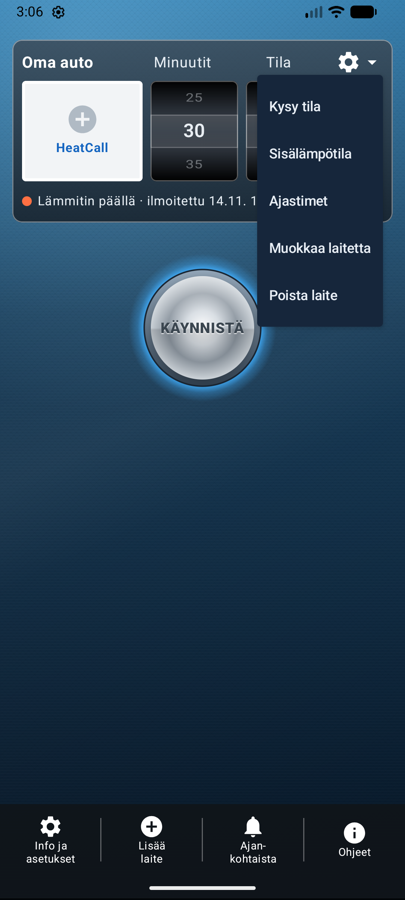</td>
<td width="33%">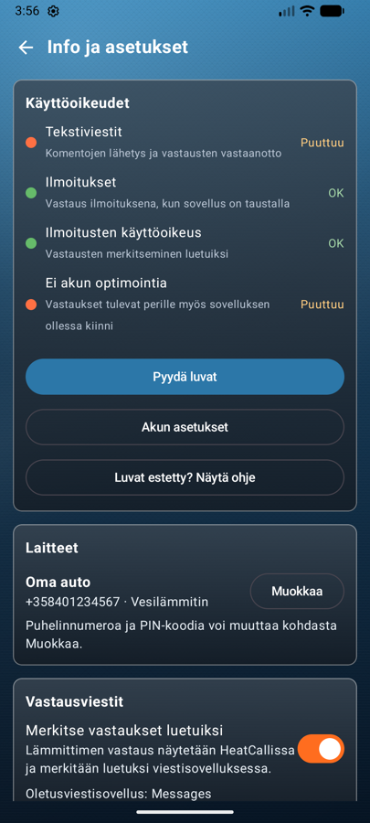</td>
<td width="33%">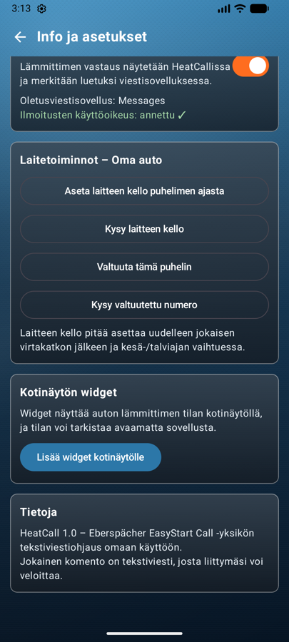</td>
</tr>
<tr>
<td><b>Rataskuvakkeen valikko</b> Kysy tila, Sisälämpötila, Ajastimet, Laitteen kello, Muokkaa laitetta ja Poista laite.</td>
<td><b>Käyttöoikeudet</b> Lupien tila yhdellä silmäyksellä: tekstiviestit, ilmoitukset, luetuksi merkintä ja akun optimointi.</td>
<td><b>Info ja asetukset</b> Laitetoiminnot, kotinäytön widgetin lisäys, vianmääritysloki ja versiotiedot.</td>
</tr>
</table>

## Käyttöönotto ja opastus

<table>
<tr>
<td width="33%">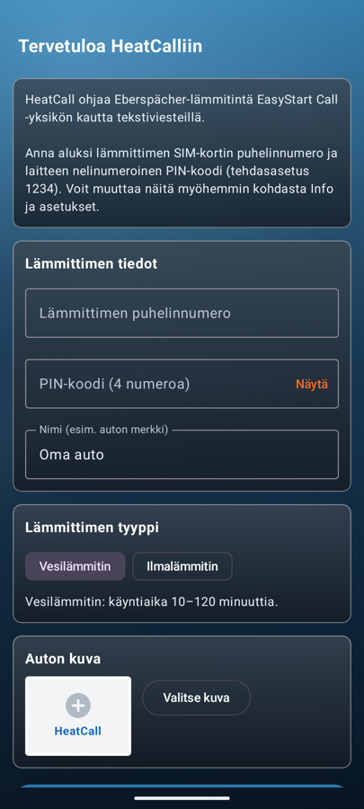</td>
<td width="33%">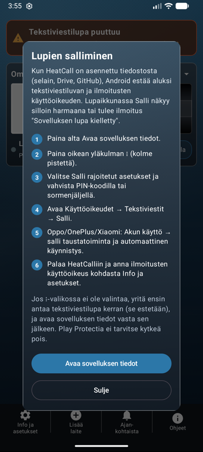</td>
<td width="33%">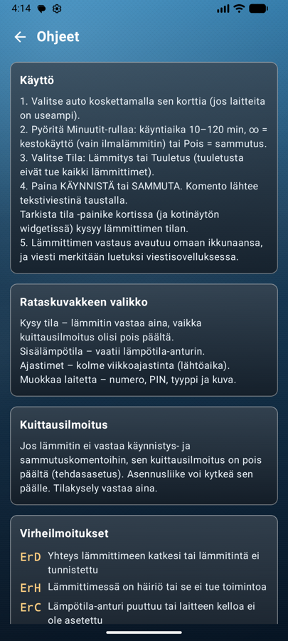</td>
</tr>
<tr>
<td><b>Ensimmäinen käynnistys</b> Sovellus kysyy lämmittimen numeron, PIN-koodin, nimen, tyypin ja halutessa auton kuvan.</td>
<td><b>Lupien salliminen</b> Jos Android estää tekstiviestiluvan (tiedostosta asennettu sovellus), HeatCall näyttää ohjeen ja avaa oikean asetussivun.</td>
<td><b>Ohjeet</b> Sovelluksen sisäinen käyttöohje, virhekoodit ja tekstiviestikomennot.</td>
</tr>
</table>

---

Lisätietoja: [Käyttöohje](KAYTTOOHJE.md) · [Asennus](ASENNUS.md) · [SMS-protokolla](SMS-PROTOKOLLA.md) · [Kehittäjälle](KEHITYS.md)
