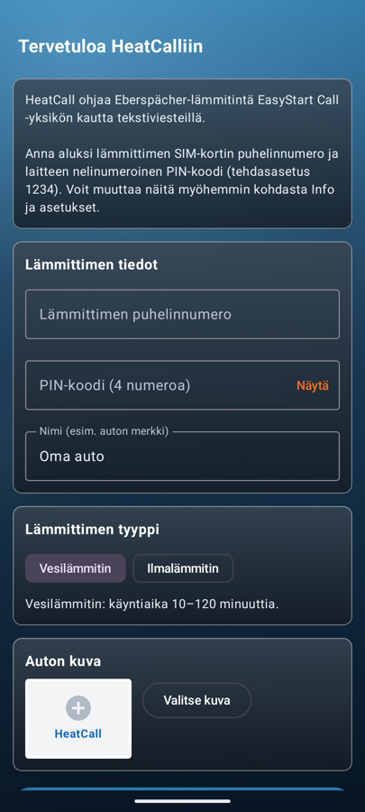
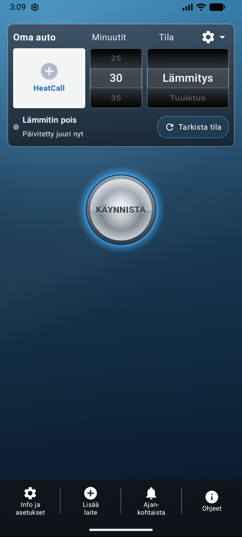
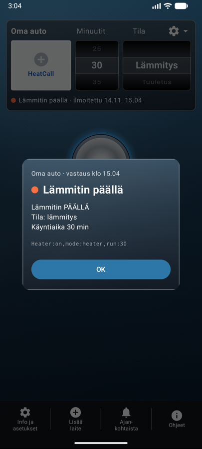
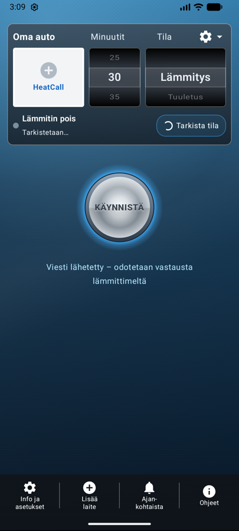
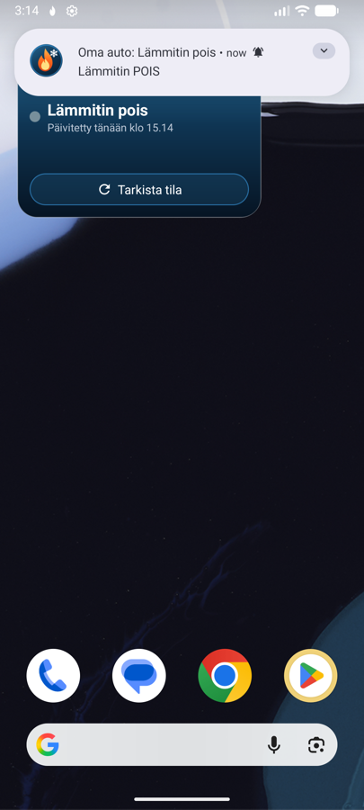
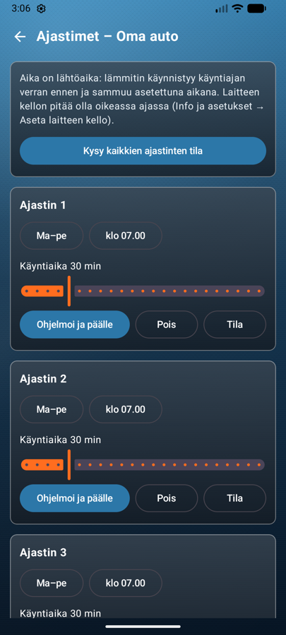
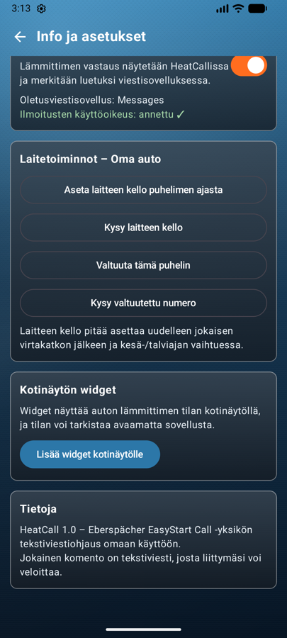

# HeatCall – käyttöohje

HeatCall ohjaa Eberspächer-seisontalämmitintä tekstiviesteillä EasyStart Call -yksikön kautta. Jokainen komento on tekstiviesti, josta liittymäsi voi veloittaa.

## 1. Ensimmäinen käynnistys

Sovellus kysyy ensimmäisellä käynnistyskerralla:

| Kenttä | Selitys |
|---|---|
| **Lämmittimen puhelinnumero** | EasyStart Callin SIM-kortin numero, esim. `+358 40 123 4567` tai `040 123 4567` |
| **PIN-koodi** | EasyStart Callin nelinumeroinen PIN (tehdasasetus `1234`) |
| **Nimi** | Auton nimi, joka näkyy kortissa ja widgetissä |
| **Lämmittimen tyyppi** | *Vesilämmitin* (Hydronic) tai *Ilmalämmitin* (Airtronic). Kestokäyttö (∞) on vain ilmalämmittimissä. |
| **Auton kuva** | Valinnainen kuva puhelimen galleriasta |

Kun tallennat tiedot, Android kysyy luvat:

- **Tekstiviestien lähetys ja vastaanotto:** pakollinen, koska ilman sitä sovellus ei voi ohjata lämmitintä
- **Ilmoitukset:** vastaus näytetään ilmoituksena, kun sovellus on taustalla

Jos tekstiviestilupa evätään (esim. Android näyttää *"Sovelluksen lupa kielletty"*), HeatCall avaa automaattisesti ohjeen **Lupien salliminen**. Ks. [Asennus → Rajoitetut asetukset](ASENNUS.md#rajoitetut-asetukset).

Numeroa ja PIN-koodia voi muuttaa myöhemmin: **Info ja asetukset → Laitteet → Muokkaa** tai rataskuvake → **Muokkaa laitetta**.

 

## 2. Päänäkymä

Jokaisella autolla on oma kortti:

- **Minuutit-rulla:** käyntiaika 10–120 minuuttia viiden minuutin välein. Kun valitset **Pois**, painike muuttuu SAMMUTA-painikkeeksi. Ilmalämmittimellä rullassa on lisäksi **∞** (kestokäyttö).
- **Tila-rulla:** **Lämmitys** tai **Tuuletus**. Tuuletus käyttää auton puhallinta ilman lämmitystä. Kaikki lämmittimet eivät tue sitä.
- **Tilarivi:** viimeisin lämmittimen ilmoittama tila ja milloin se päivittyi.
- **Tarkista tila:** kysyy lämmittimen tilan heti.
- **Rataskuvake ▾:** avaa valikon, josta löytyvät Kysy tila, Sisälämpötila, Ajastimet, Muokkaa laitetta ja Poista laite.

Pyöritä rullat haluamiisi arvoihin ja paina keskellä olevaa **KÄYNNISTÄ**-painiketta. Valinnat tallentuvat, joten seuraavalla kerralla riittää yksi painallus.

Jos autoja on useampi, valitse ohjattava auto koskettamalla sen korttia. Valittu kortti näkyy sinisellä reunuksella.

 

## 3. Vastausikkuna ja luetuksi merkintä

Kun lämmitin vastaa, vastaus avautuu omaan ikkunaansa suomeksi tulkittuna. Alkuperäinen viesti näkyy ikkunan alareunassa.

- Jos sovellus on auki, ikkuna aukeaa heti.
- Jos sovellus on taustalla, saat HeatCall-ilmoituksen, josta ikkuna aukeaa.
- Sama viesti merkitään automaattisesti **luetuksi** puhelimen viestisovelluksessa, joten se ei jää lukemattomaksi.

Luetuksi merkintä vaatii **ilmoitusten käyttöoikeuden**: **Info ja asetukset → Vastausviestit → Anna käyttöoikeus**. Asetuksista näet myös, mikä viestisovellus on puhelimen oletus ja onko käyttöoikeus annettu. Toiminnon voi kytkeä pois samasta kohdasta.

> **Huom!** Lämmitin vastaa käynnistykseen ja sammutukseen vain, jos EasyStart Callin **kuittausilmoitus** on päällä (tehdasasetus on pois). Asennusliike voi kytkeä sen päälle. Tilakyselyyn lämmitin vastaa aina.

 

## 4. Tilan tarkistus

Paina kortin **Tarkista tila** -painiketta. Sovellus lähettää komennon `heater?`, ja rivillä näkyy "Tarkistetaan…".

- Vastaus tulee yleensä muutamassa sekunnissa tai minuutissa riippuen verkosta.
- Jos vastausta ei tule 3 minuutissa, sovellus kertoo siitä. Tarkista silloin, että autossa on kenttää (esim. ettei auto ole maanalaisessa parkkihallissa).

 

## 5. Kotinäytön widget

Widget näyttää valitun auton lämmittimen tilan ja sisältää **Tarkista tila** -painikkeen, joten tilan voi tarkistaa avaamatta sovellusta.

**Lisääminen:**
- **Info ja asetukset → Kotinäytön widget → Lisää widget kotinäytölle**, tai
- paina kotinäyttöä pitkään → **Widgetit** → **HeatCall**

**Toiminta:**
- Tilapallo on oranssi, kun lämmitin on päällä, ja harmaa, kun se on pois. Läpinäkyvä pallo tarkoittaa, että tilaa ei tiedetä.
- Kun painat Tarkista tila, painikkeessa näkyy "Odotetaan vastausta", kunnes lämmitin vastaa.
- Kun kosketat widgetin muuta aluetta, sovellus aukeaa.
- Jos autoja on useampi, widget näyttää sovelluksessa valittuna olevan auton.

Widgetistä ei voi käynnistää lämmitintä, jotta lämmitin ei käynnisty vahingossa.

 

## 6. Ajastimet

Rataskuvake → **Ajastimet**. Laitteessa on kolme ajastinta (T1–T3).

- **Päivä:** yksittäinen päivä tai alue *Ma–pe*, *La–su* tai *Joka päivä*.
- **Aika on lähtöaika:** lämmitin käynnistyy käyntiajan verran ennen asetettua aikaa ja sammuu asetettuna aikana. Esimerkiksi lähtöaika 7.30 ja käyntiaika 30 min tarkoittavat, että lämmitys on päällä klo 7.00–7.30.
- **Ohjelmoi ja päälle:** lähettää ajastimen asetukset ja aktivoi ajastimen.
- **Pois:** poistaa ajastimen käytöstä.
- **Tila / Kysy kaikkien ajastinten tila:** näyttää laitteeseen tallennetut ajastimet.

Kestokäyttö ei ole mahdollinen ajastimella.

> **Tärkeää:** ajastin toimii vain, jos **laitteen kello** on oikeassa ajassa. Kello pitää asettaa uudelleen jokaisen virtakatkon jälkeen (esim. akun vaihto) ja kesä- ja talviajan vaihtuessa. Kellon voi asettaa kohdasta **Info ja asetukset → Laitetoiminnot → Aseta laitteen kello puhelimen ajasta**.

 

## 7. Info ja asetukset

| Kohta | Toiminto |
|---|---|
| Käyttöoikeudet | Lupien tila (tekstiviestit, ilmoitukset, ilmoitusten käyttöoikeus, akun optimointi), *Pyydä luvat*, *Akun asetukset* ja *Luvat estetty? Näytä ohje* |
| Laitteet | Autojen numero, PIN, tyyppi ja kuva |
| Vastausviestit | Luetuksi merkintä päälle tai pois, oletusviestisovellus ja ilmoitusten käyttöoikeus |
| Laitetoiminnot | Aseta laitteen kello puhelimen ajasta, Kysy laitteen kello, Valtuuta tämä puhelin, Kysy valtuutettu numero |
| Kotinäytön widget | Widgetin lisäys |

**Valtuuta tämä puhelin** (`mainphone:set,number:mine`) tallentaa puhelimesi numeron EasyStart Calliin valtuutetuksi numeroksi. Valtuutettuun numeroon lähetetään virheilmoitukset, eikä tästä numerosta soitettaessa kysytä PIN-koodia.

 

## 8. Alapalkki

| Painike | Sisältö |
|---|---|
| **Info ja asetukset** | Asetukset, ks. yllä |
| **Lisää laite** | Uuden auton tai lämmittimen lisäys |
| **Ajankohtaista** | Viestihistoria (150 viimeisintä). PIN-koodi näkyy muodossa `pin:****`. |
| **Ohjeet** | Lyhyt käyttöohje, virhekoodit ja komennot |

## 9. Virheilmoitukset

| Koodi | Merkitys | Toimenpide |
|---|---|---|
| `ErD:HeaterCom:lost` | Yhteys EasyStart Callin ja lämmittimen välillä katkesi | Yritä uudelleen; jos toistuu, tarkastuta asennus |
| `ErD:HeaterCom:no_heater_found` | Lämmitintä ei tunnistettu | Irrota sulake hetkeksi ja yritä uudelleen |
| `ErH:Heater:Error` | Lämmittimessä on häiriö | Yritä uudelleen; jos toistuu, vie huoltoon |
| `ErH:Heater:mode_not_supported` | Lämmitin ei tue toimintoa (esim. tuuletus) | Valitse toinen tila |
| `ErC:Temp:missing` | Lämpötila-anturia ei ole asennettu | – |
| `ErC:Temp:short_circuit` | Lämpötila-anturi on viallinen | Huolto |
| `ErC/ErR:DeviceTime:time_not_set` | Laitteen kelloa ei ole asetettu | Aseta laitteen kello |
| `ErL:DatCom:lost` | Johdotusvika | Huolto |

## 10. Vianetsintä

| Ongelma | Ratkaisu |
|---|---|
| Päänäkymässä oranssi varoitus **Tekstiviestilupa puuttuu** | Napauta varoitusta ja seuraa ohjetta, ks. [Rajoitetut asetukset](ASENNUS.md#rajoitetut-asetukset). |
| Lupaikkunassa **Salli** harmaana / *"Sovelluksen lupa kielletty"* | Sovellustiedot → ⋮ → **Salli rajoitetut asetukset**, ks. [Asennus](ASENNUS.md#rajoitetut-asetukset). |
| Vastaukset tulevat vain, kun sovellus on auki (Oppo, Xiaomi ym.) | Salli taustatoiminta ja automaattinen käynnistys, ks. [ColorOS](ASENNUS.md#oppo--oneplus--realme-coloros). |
| Lämmitin ei vastaa mihinkään | Tarkista, että autossa on kenttää, EasyStart Callin SIM-kortti on voimassa ja numero on oikein. Kokeile **Tarkista tila**. |
| Tilakysely toimii, mutta käynnistykseen ei tule vastausta | Kuittausilmoitus on pois päältä (tehdasasetus). Lämmitin todennäköisesti käynnistyi; varmista asia tilakyselyllä. |
| "Laitteen numero tai PIN puuttuu" | Täydennä tiedot kohdassa Muokkaa laitetta. |
| Vastaus ei merkitty luetuksi | Anna ilmoitusten käyttöoikeus (Info ja asetukset). Jos Android ilmoittaa "rajoitettu asetus", katso [Asennus](ASENNUS.md#rajoitetut-asetukset). |
| Ajastin ei käynnistä lämmitintä | Aseta laitteen kello. Tarkista ajastimen tila (Tila-painike). |
| "Ei verkkoyhteyttä" tai "Lentokonetila on päällä" | Viestiä ei lähetetty puhelimesta. Tarkista puhelimen oma yhteys. |
