# HeatCall – features

[Suomi](../ESITTELY.md) · **English**

HeatCall controls an Eberspächer parking heater by text message through the EasyStart Call unit. It has a clear, dark look: a blue background, scroll wheels and a large start button. The app is available in Finnish and English.

The screenshots were taken on an Android 17 emulator with simulated heater replies. The phone numbers in them are test numbers.

---

## Control

<table>
<tr>
<td width="33%">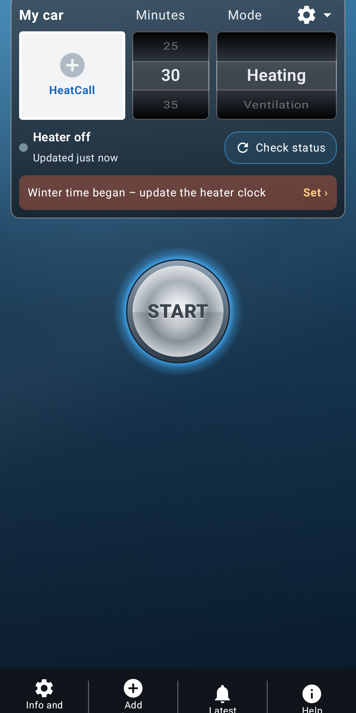</td>
<td width="33%">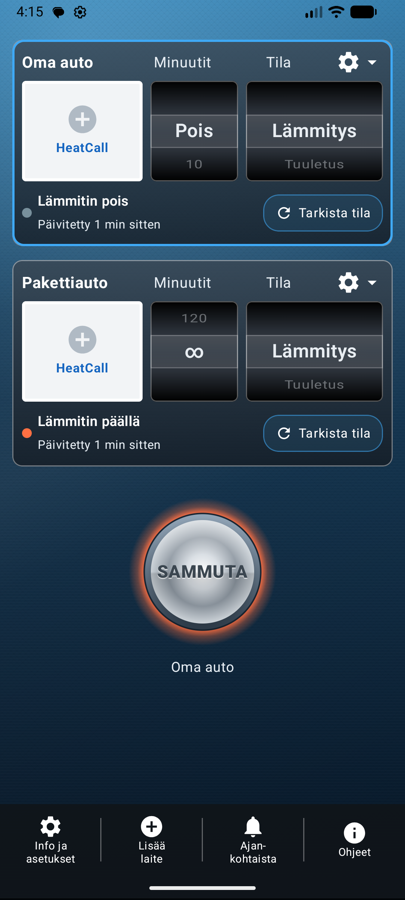</td>
<td width="33%">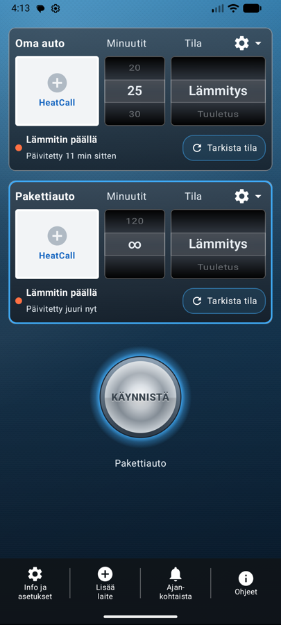</td>
</tr>
<tr>
<td><b>Start</b> Choose the run time on the Minutes wheel and the mode on the Mode wheel, then press <b>START</b>. The command is sent as a text message in the background.</td>
<td><b>Stop</b> When the Minutes wheel shows <b>Off</b>, the button turns into an orange <b>STOP</b> button.</td>
<td><b>Several cars</b> Each car has its own card, number, PIN and heater type. The selected car has a blue border. With an air heater, the wheel also has <b>∞</b>, which means continuous operation.</td>
</tr>
</table>

## Status and replies

<table>
<tr>
<td width="33%">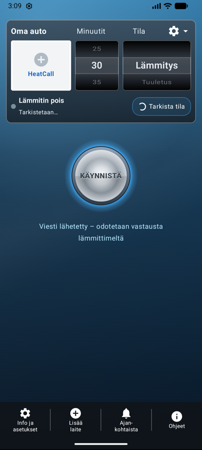</td>
<td width="33%">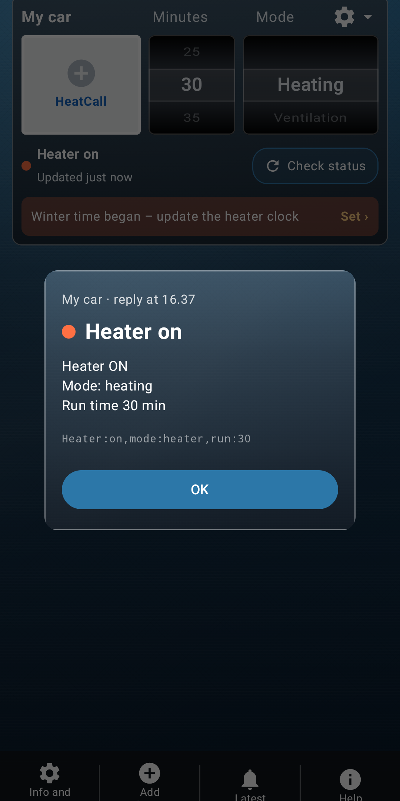</td>
<td width="33%">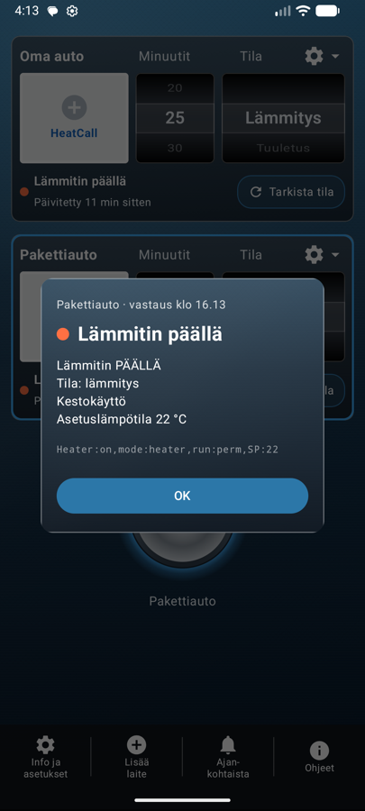</td>
</tr>
<tr>
<td><b>Check status</b> The button on the card sends a status query. The status line shows the latest status and when it was updated.</td>
<td><b>Reply window</b> The heater's reply opens in its own window, translated into plain language. The same message is marked as read in the messaging app.</td>
<td><b>Air heater</b> Continuous operation and the set temperature are interpreted and shown in plain language.</td>
</tr>
<tr>
<td width="33%">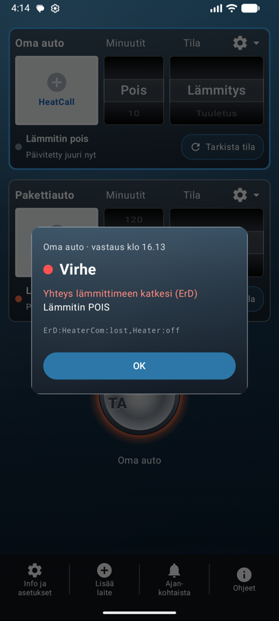</td>
<td width="33%">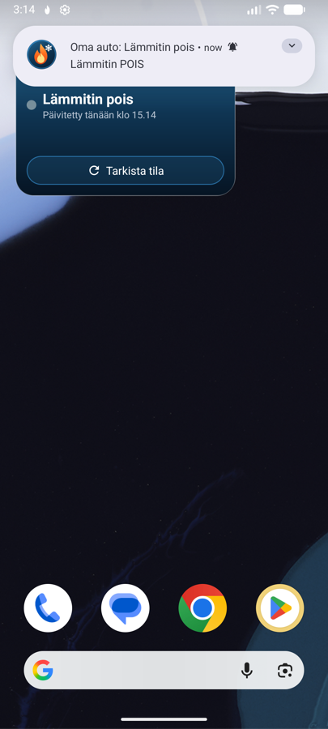</td>
<td width="33%">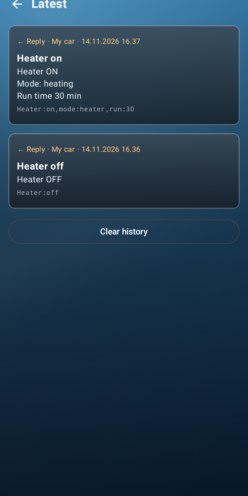</td>
</tr>
<tr>
<td><b>Error messages</b> Error codes (ErD, ErH, ErC, ErR, ErL) are explained in plain language.</td>
<td><b>Home screen widget and notification</b> The widget shows the status and lets you check it without opening the app. When the app is in the background, the reply arrives as a notification.</td>
<td><b>Latest</b> Message history: sent commands (with the PIN code hidden) and interpreted replies.</td>
</tr>
</table>

## Timers and device clock

<table>
<tr>
<td width="33%">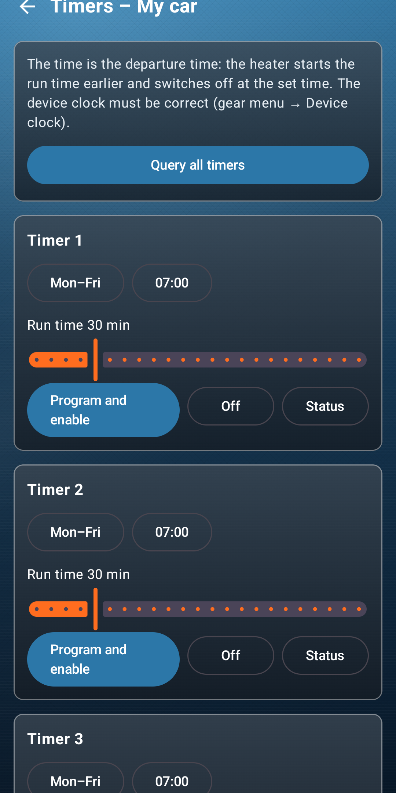</td>
<td width="33%">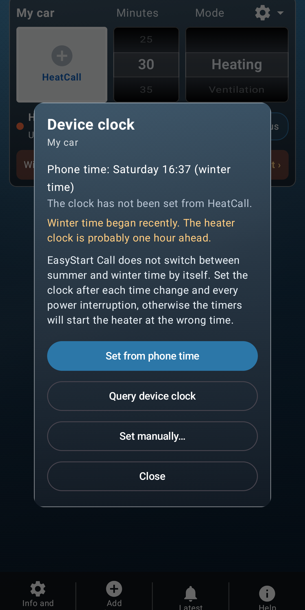</td>
<td width="33%">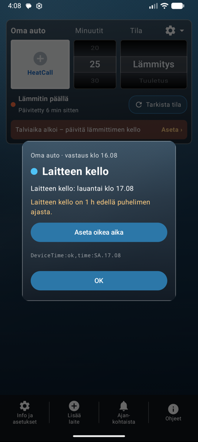</td>
</tr>
<tr>
<td><b>Timers T1–T3</b> A day or a range of days (Mon–Fri, Sat–Sun, Every day), a departure time and a run time. Program a timer, switch it off or query its status.</td>
<td><b>Device clock</b> Set the clock from the phone time, query it or set it manually. When summer or winter time begins, the card shows a reminder.</td>
<td><b>Clock offset</b> The reply to a clock query shows how far the device clock is off, for example "1 h ahead", and offers a <b>Set correct time</b> button.</td>
</tr>
</table>

## Menus and settings

<table>
<tr>
<td width="33%">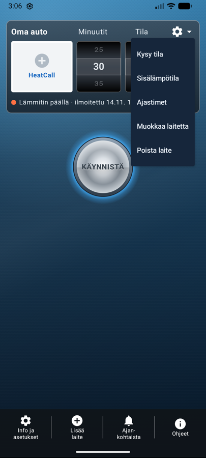</td>
<td width="33%">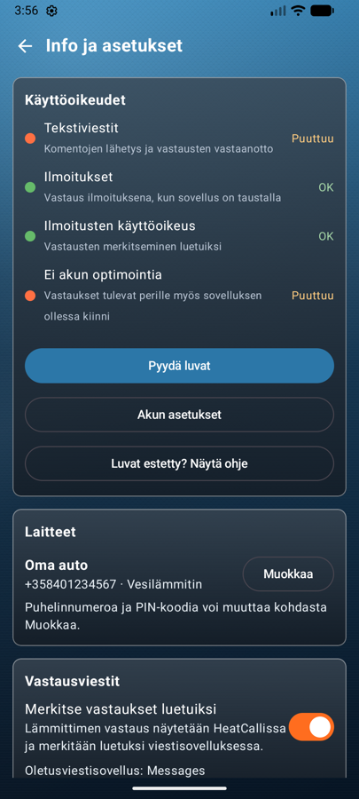</td>
<td width="33%">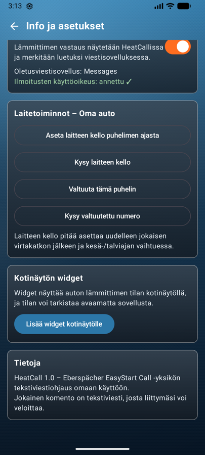</td>
</tr>
<tr>
<td><b>Gear menu</b> Check status, Interior temperature, Timers, Device clock, Edit device and Delete device.</td>
<td><b>Permissions</b> The state of all permissions at a glance: text messages, notifications, marking as read and battery optimisation.</td>
<td><b>Info and settings</b> Device functions, adding the home screen widget, the troubleshooting log and version information.</td>
</tr>
</table>

## Setup and guidance

<table>
<tr>
<td width="33%">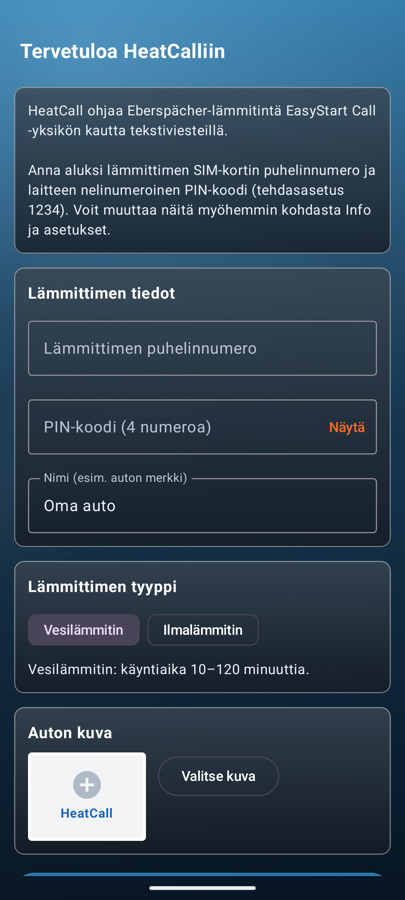</td>
<td width="33%">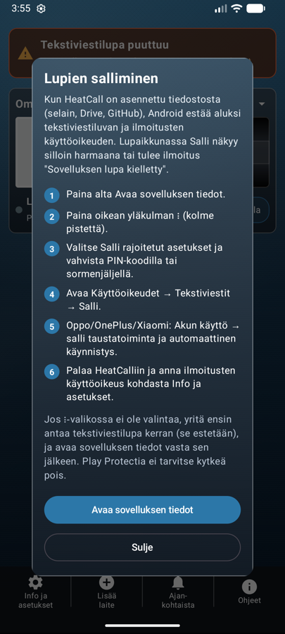</td>
<td width="33%">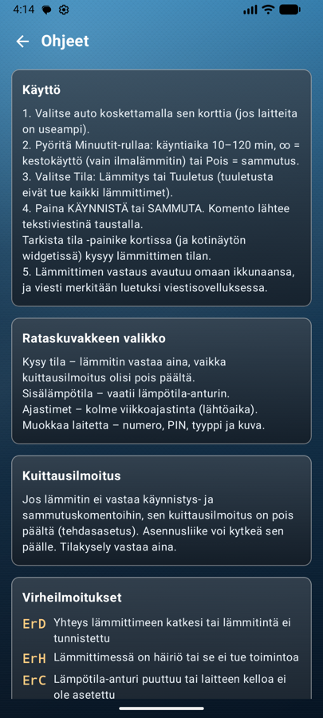</td>
</tr>
<tr>
<td><b>First start</b> The app asks for the heater's phone number, PIN code, name, type and, if you want, a photo of the car.</td>
<td><b>Allowing permissions</b> If Android blocks the SMS permission (an app installed from a file), HeatCall shows instructions and opens the right settings page.</td>
<td><b>Help</b> The in-app user guide, error codes and text message commands.</td>
</tr>
</table>

---

More information: [User guide](USER-GUIDE.md) · [Installation](INSTALLATION.md) · [SMS protocol](SMS-PROTOCOL.md) · [For developers](DEVELOPMENT.md)
