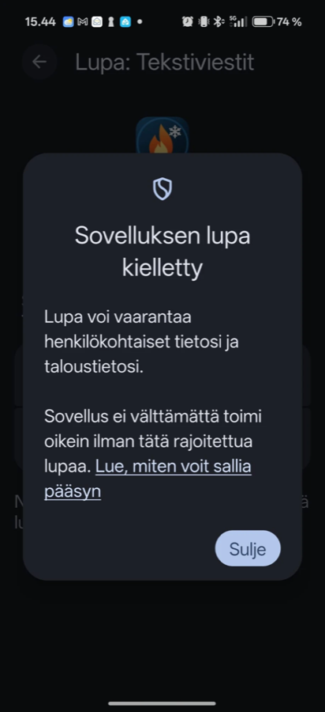
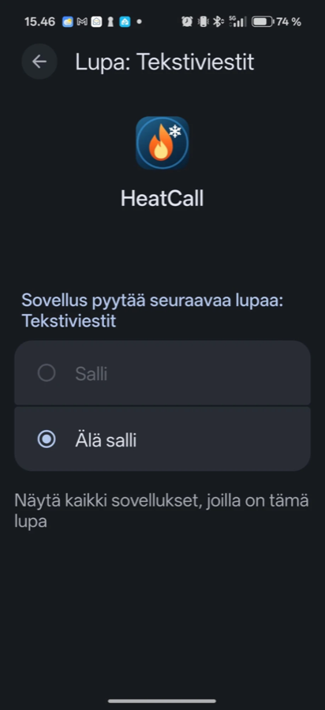
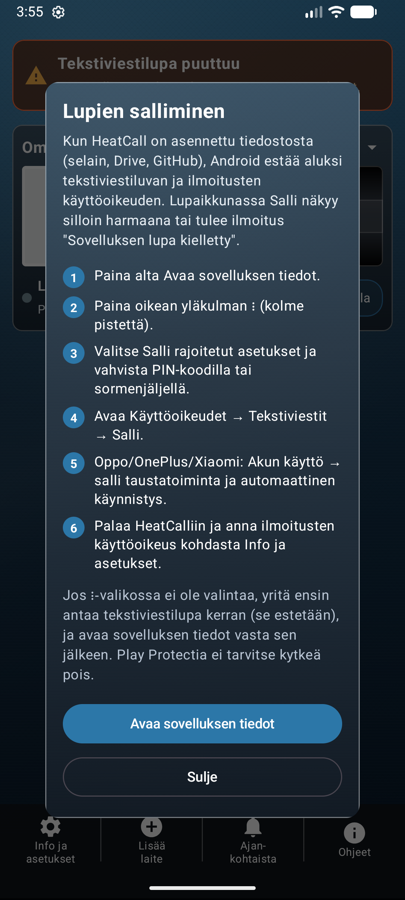
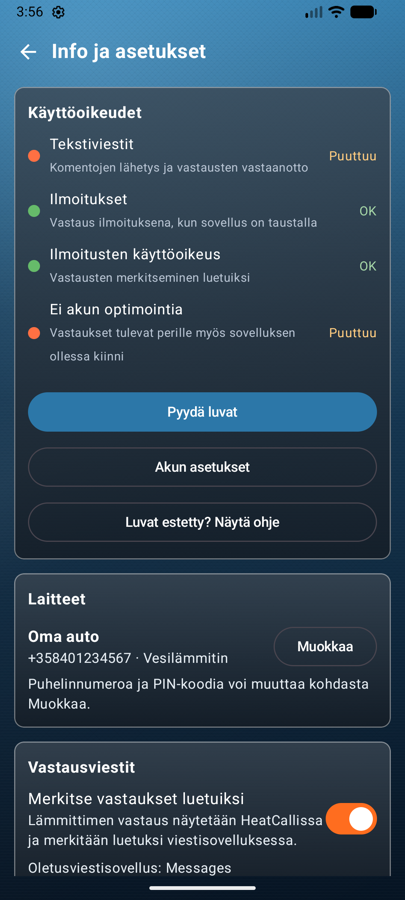

# HeatCall – Installation

[Suomi](../ASENNUS.md) · **English**

HeatCall is coming to Google Play. Until then it is installed from an APK file (sideloading). The app works on Android 10 and newer.

## APK file

Download the latest APK from [Releases](https://github.com/Konderi/HeatCall/releases).

When you build it yourself, the APK is in two places:

| Path | Description |
|---|---|
| `app/build/outputs/apk/release/app-release.apk` | Release APK produced by Gradle |
| `dist/HeatCall-<version>.apk` | The same file named for sharing, e.g. `HeatCall-1.2.apk` (not in version control) |

For building, see [DEVELOPMENT.md](DEVELOPMENT.md#building).

## Option 1: USB cable (recommended)

1. Enable developer options on the phone: **Settings → About phone → Build number**, tap it 7 times.
2. Turn on **Settings → System → Developer options → USB debugging**.
3. Connect the phone to the computer and accept USB debugging on the phone.
4. Either open the project in Android Studio, select the phone and press ▶ **Run**, or on the command line:

```bash
~/Library/Android/sdk/platform-tools/adb install -r dist/HeatCall-1.2.apk
```

When installed with a cable, Android does not treat the app as coming from an "unknown source", so [restricted settings](#restricted-settings-android-13) do not apply.

## Option 2: Without a cable

### Email – does not work with Gmail

**Gmail blocks `.apk` attachments**, even inside a zip, so email is not a reliable option. Other email services may work, but a cloud link is safer.

### Options that work

| Option | How |
|---|---|
| **GitHub Release** | Open [Releases](https://github.com/Konderi/HeatCall/releases) in the phone's browser and download the APK. |
| **Google Drive / iCloud Drive / OneDrive** | Upload the APK from the computer and open it on the phone in the cloud app or browser. |
| **Quick Share / Nearby Share** | Share the file directly from another Android device or a Windows PC. |
| **Wireless debugging** | Android 11+: Developer options → Wireless debugging → Pair device with pairing code. Then `adb pair` and `adb connect`, after which installation works as with a cable. |

### Installing on the phone

1. Open the downloaded APK (e.g. Files → Downloads).
2. Android asks for permission to install unknown apps from the app you opened the file with (browser, Drive, Files). Allow it.
3. **Play Protect** may warn about an unknown developer. Choose **More details → Install anyway**. The warning appears because the app is not installed from Google Play.
4. Open HeatCall and complete the [first start](USER-GUIDE.md#1-first-start) settings.

## Restricted settings (Android 13+)

From Android 13, an app installed from a file, browser, Drive or GitHub cannot request sensitive permissions straight away. For HeatCall this affects:

- the **SMS permission**, without which the app does not work at all
- **notification access**, which mark as read needs

Apps installed with a USB cable (`adb install` or Android Studio) or from Google Play are not affected.

### Symptoms

<p>
  
  
</p>

*(Screenshots from a Finnish-language phone.)*

- When you try to grant the permission, you get the message **"App permission denied – This permission could put your personal and financial information at risk"**.
- On the **SMS permission** page, *Don't allow* is selected and **Allow** is greyed out.
- HeatCall's main screen shows an orange **SMS permission missing** warning.

### Fix

1. Close the message. You need to try granting the permission once, because the allow option only appears after that.
2. Open HeatCall's **App info** page, the one with *Uninstall* and *Force stop*:
   - in HeatCall: tap the warning, or **Info and settings → Permissions blocked? Show help → Open app info**, or
   - long-press the HeatCall icon → **ⓘ App info**, or
   - **Settings → Apps → (App management) → HeatCall**
3. Tap **⋮** in the top-right corner → **Allow restricted settings** and confirm with your PIN or fingerprint.
4. **Permissions → SMS → Allow**. Allow can now be selected.
5. Go back to HeatCall. Grant notification access in **Info and settings → Reply messages → Grant access**.

Note: the **⋮** menu is not on the individual permission page (*SMS permission*). It is on the app's **main info page**.

### Guidance in the app

<p>
  
  
</p>

- If the SMS permission is denied, HeatCall automatically opens the **Allowing permissions** guide, which has an **Open app info** button.
- **Info and settings → Permissions** shows the status (OK / Missing) of every permission: SMS, notifications, notification access and battery optimisation.

## Oppo / OnePlus / Realme (ColorOS)

The following differences were found on ColorOS phones. Test device: Oppo Find 9X Pro.

| Situation | Solution |
|---|---|
| The installer runs a security check or asks for an OPPO account | Choose **Install without scanning** or **Install anyway** at the bottom. No sign-in is needed. |
| The "Install unknown apps" setting cannot be found | **Settings → Password & security → System security → Install unknown apps**, **Settings → Apps → Special app access**, or search Settings for "unknown". The permission is given to the app you open the APK with (Chrome, File Manager). |
| The **Play Protect** setting is greyed out | You **do not need** to turn Play Protect off. In the install warning, *More details → Install anyway* is enough. The switch is greyed out e.g. during a phone call (Google's scam protection). |
| SMS permission blocked, Allow greyed out | See [Restricted settings](#restricted-settings-android-13). |
| Replies or the widget do not update while the app is closed | **Info and settings → Permissions → Background activity settings**. HeatCall detects the phone brand and shows the right path: on ColorOS *App info → Battery usage* → allow **background activity** and **auto launch**. |

Menu names vary between ColorOS versions. If you cannot find an item, use the Settings search.

On other brands (Samsung, Xiaomi, Pixel) the restricted settings fix is the same.

## Background activity by brand

**Info and settings → Permissions → Background activity settings** detects the phone manufacturer and shows the right steps and buttons. If the detection is wrong, you can pick another brand in the dialog.

| Brand | Setting | Buttons |
|---|---|---|
| Samsung (One UI) | App info → Battery → **Unrestricted**. Also Device care → Battery → Background usage limits → **Never sleeping apps** → HeatCall | App info, battery settings |
| Google Pixel | App info → App battery usage → **Unrestricted** | App info |
| OPPO / OnePlus / realme (ColorOS) | App info → Battery usage → **Allow background activity** and **Allow auto launch** | App info, auto launch |
| Xiaomi / Redmi / POCO (HyperOS/MIUI) | **Autostart** allowed, Battery → **No restrictions** | Autostart, battery settings |

Manufacturers' own settings screens vary by model. If a screen cannot be opened, HeatCall opens the app info page and tells you.

## Updating

Install the new version over the old one in the same way. Your data (devices, timers, history) is kept.

**Signing:** an update only installs if the new APK is signed with the **same key** as the installed version. The release build is currently signed with the build machine's Android debug key (`~/.android/debug.keystore`). Therefore:

- Build updates on the same machine, or keep a copy of `debug.keystore`.
- If the key changes, the old version must be uninstalled before installing the new one. Your data is lost.
- The Google Play version is signed with a different key. Uninstall the sideloaded version before installing from Play.

For wider distribution, create your own release key. See [DEVELOPMENT.md](DEVELOPMENT.md#signing).

## Another phone

The same APK works on any Android 10+ phone. The heater number and PIN are entered separately on each phone. If you want another phone to receive the heater's error messages too, authorise it in **Info and settings → Authorise this phone**. Note that EasyStart Call can have only one authorised number at a time.
