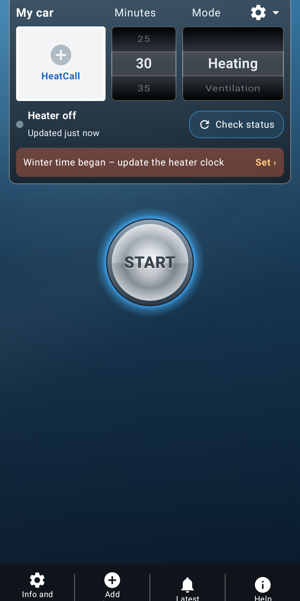
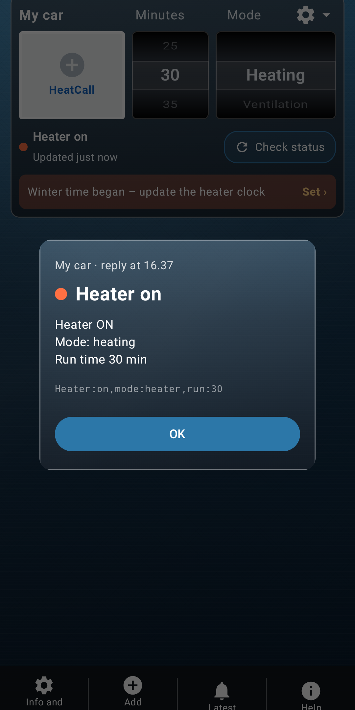
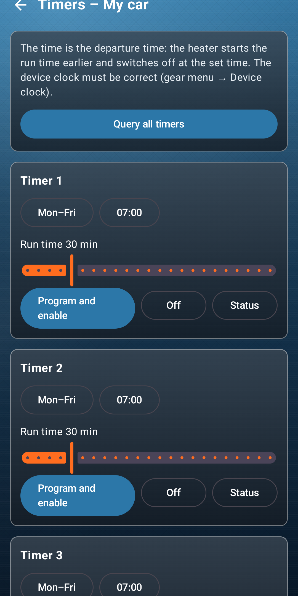
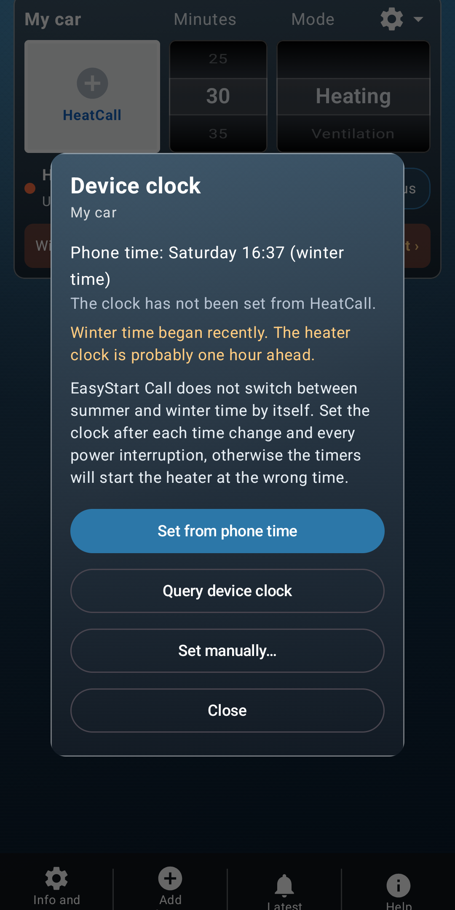

# HeatCall – User guide

[Suomi](../KAYTTOOHJE.md) · **English**

HeatCall controls an Eberspächer parking heater (Hydronic or Airtronic) by text message through the **EasyStart Call** GSM remote control. It replaces the manufacturer's original app, which is no longer supported and does not work on recent Android versions.

HeatCall is **free and open source**. It has no ads, no analytics and no internet permission. Every command is a text message that your operator may charge for.

> HeatCall is an independent app. It is not a product of Eberspächer Climate Control Systems GmbH and is not endorsed by it. Eberspächer and EasyStart are trademarks of their respective owners.

**Contents:** [Requirements](#requirements) · [Installation](#installation) · [First start](#1-first-start) · [Main screen](#2-main-screen) · [Replies](#3-reply-window-and-mark-as-read) · [Widget](#4-home-screen-widget) · [Timers](#5-timers) · [Device clock](#6-device-clock) · [Settings](#7-info-and-settings) · [Error codes](#8-error-codes) · [Troubleshooting](#9-troubleshooting)

## Requirements

- An Eberspächer heater (Hydronic or Airtronic) with an **EasyStart Call** unit
- An active SIM card in the EasyStart Call unit
- An Android phone, Android 10 or newer
- For start and stop confirmations, the unit's **confirmation messages** must be enabled (factory default is off, your installer can enable it). Status queries are always answered.

Tested on Google Pixel and OPPO (ColorOS). The app includes background-activity guidance for Samsung and Xiaomi too.

## Installation

- **Google Play:** HeatCall is coming to Google Play. The closed test is running now. To join, email **heatcall@konderi.fi** with the address of your Google account (the one you use for Play Store).
- **APK:** download the latest `.apk` from [Releases](https://github.com/Konderi/Diesel-lammitin/releases) on your phone, open it and allow installing from an unknown source. If Play Protect warns you, choose **More details → Install anyway**.

If Android blocks the SMS permission (*"App permission denied"* or **Allow** greyed out), see [Installation → Restricted settings](INSTALLATION.md#restricted-settings-android-13). Full instructions, including installing with a USB cable, background activity settings by phone brand and updating, are in [INSTALLATION.md](INSTALLATION.md). Building from source: [DEVELOPMENT.md](DEVELOPMENT.md).

## 1. First start

On first start HeatCall asks for:

| Field | Description |
|---|---|
| **Kieli / Language** | Finnish or English. Defaults to the phone language. Change it later in **Info and settings → Language**. |
| **Heater phone number** | The number of the SIM card in the EasyStart Call unit, e.g. `+358 40 123 4567` |
| **PIN** | The four-digit EasyStart Call PIN (factory default `1234`) |
| **Name** | The car name shown on the card and the widget |
| **Heater type** | *Coolant heater* (Hydronic) or *Air heater* (Airtronic). Continuous mode (∞) is only available for air heaters. |
| **Car photo** | Optional photo from your gallery |

When you save, Android asks for the **SMS** permission (required) and **notifications** (replies when the app is in the background). If the SMS permission is blocked, HeatCall opens the **Allowing permissions** guide, see [Restricted settings](INSTALLATION.md#restricted-settings-android-13).

You can change the number and PIN later in **Info and settings → Devices → Edit** or gear menu → **Edit device**.

## 2. Main screen

Each car has its own card:

- **Minutes wheel:** run time 10–120 minutes in 5-minute steps. Choosing **Off** turns the button into **STOP**. Air heaters also have **∞** (continuous).
- **Mode wheel:** **Heating** or **Ventilation**. Ventilation runs the car's blower without heating. Not all heaters support it.
- **Status line:** the last status reported by the heater and when it was updated.
- **Check status:** queries the heater right away.
- **Gear menu ▾:** Status query, Interior temperature, Timers, **Device clock**, Edit device and Delete device.
- **Summer/winter time reminder:** for three weeks after a time change the card shows *"Winter time began – update the heater clock"* until the clock has been set.

Turn the wheels and press **START**. Your choices are saved, so next time one press is enough. With several cars, tap a card to select it. The selected card has a blue border.

 

## 3. Reply window and mark as read

The heater's reply opens in its own window in plain language. The original message is shown at the bottom.

- If the app is open, the window appears immediately.
- If the app is in the background, you get a HeatCall notification that opens the window.
- The same message is automatically **marked as read** in your messaging app.

Mark as read needs **notification access**: **Info and settings → Reply messages → Grant access**. HeatCall first explains what the permission is used for and opens Android's settings from *Continue to settings*. You can turn the feature off in the same place.

A status query normally gets a reply within seconds or a minute, depending on the network. If there is no reply within 3 minutes, HeatCall tells you. Check that the car has mobile coverage (an underground car park often does not).

 

## 4. Home screen widget

The widget shows the heater status of the selected car and has a **Check status** button, so you can check without opening the app.

- Add it from **Info and settings → Home screen widget → Add widget to home screen**, or long-press the home screen → **Widgets** → **HeatCall**.
- The dot is orange when the heater is on, grey when off and hollow when the status is unknown.
- Tapping elsewhere on the widget opens the app.

The widget cannot start the heater, so it cannot be started by accident.

## 5. Timers

Gear menu → **Timers**. The unit has three weekly timers (T1–T3).

- **Day:** a single day or *Mon–Fri*, *Sat–Sun* or *Every day*.
- **The time is the departure time:** the heater starts the run time earlier and switches off at the set time. Departure 07:30 with 30 min run time means heating from 07:00 to 07:30.
- **Program and enable** sends the timer and activates it. **Off** disables it. **Status** / **Query all timers** shows what is stored in the unit.

Continuous mode cannot be used with timers.

> **Important:** timers only work if the **device clock** is correct. See [Device clock](#6-device-clock).

 

## 6. Device clock

EasyStart Call only knows the weekday and time. **It does not switch between summer and winter time by itself**, so after a time change the timers start one hour off. The clock must also be set again after every power interruption (e.g. battery replacement).

Open **gear menu → Device clock**, or tap the card's reminder.

| Button | Action |
|---|---|
| **Set from phone time** | Sends the phone's weekday and time. The phone time is always in the correct summer or winter time. |
| **Query device clock** | Asks the unit for its time. The reply window compares it with the phone, e.g. *"The device clock is 1 h ahead of the phone"*, and offers **Set correct time**. Differences under 10 minutes are SMS delay and shown as correct. |
| **Set manually…** | Choose the weekday and time yourself. |

 

## 7. Info and settings

| Section | What it does |
|---|---|
| Language | Finnish / English. Applies immediately to the app, notifications and widget. |
| Permissions | Status of SMS, notifications, notification access and battery optimisation. *Request permissions*, *Background activity settings* (steps for Samsung, Pixel, OPPO/OnePlus/realme and Xiaomi) and *Permissions blocked? Show help*. |
| Devices | Number, PIN, type and photo of each car |
| Reply messages | Mark as read on/off, default messaging app and notification access |
| Device functions | Set device clock from phone time, Query device clock, **Authorise this phone**, Query authorised number |
| Home screen widget | Add the widget |
| About | Version, privacy policy and source code |

**Authorise this phone** stores your number in EasyStart Call as the authorised number. Error messages are sent to that number, and calls from it are not asked for a PIN. The unit has only one authorised number at a time.

The bottom bar has **Info and settings**, **Add** (new car or heater), **Latest** (message history, the 150 most recent, PIN shown as `pin:****`) and **Help** (short guide, error codes and commands).

## 8. Error codes

| Code | Meaning | What to do |
|---|---|---|
| `ErD:HeaterCom:lost` | Connection between EasyStart Call and the heater lost | Try again. If it repeats, have the installation checked. |
| `ErD:HeaterCom:no_heater_found` | Heater not detected | Remove the fuse for a moment and try again. |
| `ErH:Heater:Error` | Heater fault | Try again. If it repeats, take it to service. |
| `ErH:Heater:mode_not_supported` | The heater does not support the function (e.g. ventilation) | Choose another mode. |
| `ErC:Temp:missing` | No temperature sensor installed | – |
| `ErC:Temp:short_circuit` | Temperature sensor faulty | Service |
| `ErC/ErR:DeviceTime:time_not_set` | Device clock not set | Set the device clock. |
| `ErL:DatCom:lost` | Wiring fault | Service |

## 9. Troubleshooting

| Problem | Solution |
|---|---|
| Orange **SMS permission missing** warning, or **Allow** greyed out | See [Restricted settings](INSTALLATION.md#restricted-settings-android-13). |
| Replies only arrive while the app is open (OPPO, Xiaomi …) | **Info and settings → Permissions → Background activity settings**. On ColorOS: *App info → Battery usage* → allow **background activity** and **auto launch**. On Samsung set battery to **Unrestricted**. |
| The heater does not reply at all | Check that the car has coverage, the EasyStart Call SIM is active and the number is correct. Try **Check status**. |
| Status query works but start gets no reply | Confirmation messages are off (factory default). The heater most likely started. Confirm with a status query. |
| Reply not marked as read | Check **Info and settings → Permissions**: notification access = OK. Allow background activity. Then send a status query and open **Info and settings → Troubleshooting: mark as read**, which shows the 30 latest events (sender and notification action names only, no message content). Share the log with heatcall@konderi.fi if it does not help. |
| Timer does not start the heater, or starts it an hour off | The device clock is wrong, usually after a summer/winter time change. **Gear menu → Device clock → Set from phone time**. |
| "No network" or "Airplane mode is on" | The message was not sent from the phone. Check the phone's own connection. |

## More

- [Features](FEATURES.md): all features with screenshots
- [SMS protocol](SMS-PROTOCOL.md): EasyStart Call commands and reply formats
- [Development](DEVELOPMENT.md): architecture, building and testing
- Privacy policy: https://konderi.github.io/privacy/heatcall/
- Feedback and questions: heatcall@konderi.fi
